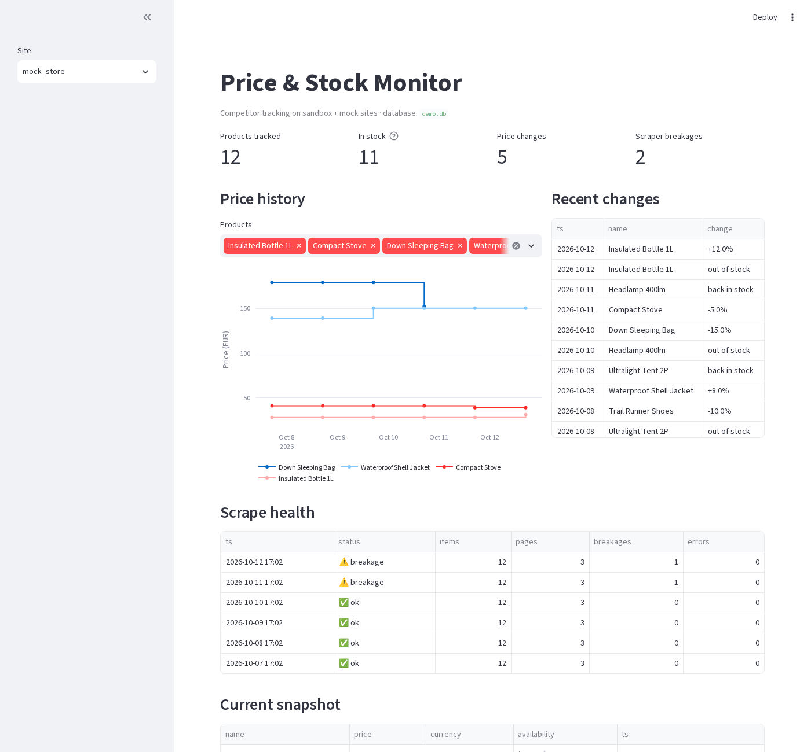
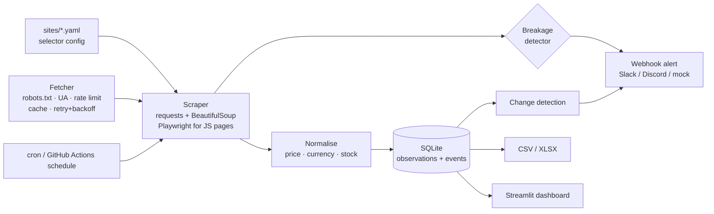

# Price & Stock Monitor

**A small online store wants to know when competitors change prices or run out of stock.** This pipeline scrapes competitor catalogues on a schedule, keeps a price/availability history in SQLite, detects changes (price drop/rise %, back in stock / out of stock), pings a Slack/Discord webhook, exports CSV/XLSX, and shows it all in a Streamlit dashboard. **New sites are added with a YAML file — no code.**



> Built and demoed **only against scraping sandboxes** (`books.toscrape.com`, `webscraper.io/test-sites`) and a **local mock store** whose prices change over simulated days. See [Ethics](#ethics--legal).

## How it works



## Quick start

```bash
pip install -r requirements.txt && playwright install chromium   # chromium only needed for the JS-rendered site
python scripts/demo.py            # 6 simulated days on the local mock store -> demo.db (add --live for the sandbox sites)
PRICEMON_DB=demo.db streamlit run dashboard.py
python -m pricemon run --only books_toscrape,webscraper_static,webscraper_js   # real (sandbox) run -> pricemon.db
python -m pricemon export exports/report.xlsx    # or .csv
pytest -q
```

## Add a site (no code)

```yaml
name: my_shop
base_url: https://shop.example.com
start_urls: [/category/shoes]
item: div.product-card            # one element per product
next_page: a[rel=next]            # pagination
render: static                    # or `js` (+ wait_for: selector) -> Playwright
fields:
  sku:   {selector: ".", attr: data-sku}
  name:  h2 a
  url:   {selector: h2 a, attr: href}
  price: span.price               # "£1,299.00", "1.299,00 €"... all normalised
  availability: .stock            # "Sold out" / "In stock (22 available)" -> enum
```
Fields support `attr`, `regex` (first group) and `default`. Included: [books.toscrape](sites/books_toscrape.yaml), [webscraper static](sites/webscraper_static.yaml), [webscraper JS-rendered](sites/webscraper_js.yaml), [local mock](sites/mock_store.yaml).

## Results

Real output of `python scripts/demo.py --live` ([docs/demo_output.txt](docs/demo_output.txt)):

| Run | Result |
|---|---|
| Mock store, 6 simulated days | 12 products × 6 days = 72 observations, **10 change events** (5 price moves from −15% to +12%, 3 out-of-stock, 2 back-in-stock) |
| Day 4 "site redesign" (price class renamed) | **Breakage alert fired**: `field 'price' (selector 'span.price') empty for 5/5 items on …/catalog/page-1.html` — instead of silently storing nulls |
| books.toscrape.com | 60 items over 3 paginated pages, GBP prices, availability parsed |
| webscraper.io static | 12 items over 2 pages (site has no stock info → `unknown`) |
| webscraper.io ajax (Playwright) | 6 items injected client-side; a plain HTTP fetch sees 0 cards |
| Tests | 32 passing: saved HTML fixtures, retry/backoff, robots, cache, rate limit, change detection, breakage, end-to-end vs mock server, CSV/XLSX |

Sample alerts:
```
📉 [mock_store] Trail Runner Shoes: 89.90 EUR → 80.91 EUR (-10.0%)
⛔ [mock_store] Ultralight Tent 2P: out of stock
🚨 Scraper breakage detected — selectors need attention
• mock_store: field 'price' (selector 'span.price') empty for 5/5 items on http://127.0.0.1:8765/catalog/page-1.html
```

## Design notes

- **Polite by construction:** `robots.txt` is fetched and obeyed per origin (unreachable or 5xx robots ⇒ don't scrape), explicit `User-Agent` with a contact URL, per-host rate limit (default 1 req/s), on-disk response cache (default TTL 1 h), capped page counts.
- **Resilience:** retries with exponential backoff on connection errors and 429/5xx (honours `Retry-After`); 4xx are not retried; a failing site is reported, not fatal to the other sites.
- **Breakage detector:** if the item selector matches nothing, or a required field (`sku`, `name`, `price`) is empty for more than 20% of items (`min_fill`), an alert is raised and the CLI exits non-zero. Silent nulls are how scrapers rot.
- **Change detection:** every run stores an observation; events compare against the previous one. Price moves below `--min-pct` (default 1%) are ignored; `unknown` availability never triggers stock events.
- **Alerts:** `ALERT_WEBHOOK_URL` + `ALERT_WEBHOOK_KIND=slack|discord`. Unset ⇒ **mock** (prints and appends to `alerts.log`). Nothing leaves your machine by default.
- **Scheduling:** [`monitor.yml`](.github/workflows/monitor.yml) runs daily on GitHub Actions (history DB persisted via the Actions cache, XLSX uploaded as artifact); or plain cron: `0 6 * * * cd /path && .venv/bin/python -m pricemon run`.
- **Dashboard:** KPIs, step-line price history per product, recent changes, scrape-health table (breakages visible), snapshot + CSV download.

## Limitations

- Static selectors: a redesign breaks a site until its YAML is updated (the detector tells you quickly; it doesn't self-heal).
- Product identity = the `sku` selector. Matching the *same* product across different competitors (EAN / fuzzy names) is not implemented.
- No proxy rotation, CAPTCHA handling or anti-bot evasion — deliberately. Sites that block bots are out of scope.
- Price history on GitHub Actions lives in a cache (can be evicted); use a persistent volume or a real DB in production.
- One currency per row, no FX conversion. Email alerts need a webhook-to-email bridge (Zapier/n8n); SMTP isn't built in.
- Playwright launches a fresh browser per page (simple, slower).

## Ethics & legal

This repo is a **portfolio demo**. It only targets sites that exist to be scraped (`books.toscrape.com`, `webscraper.io/test-sites`) and a local mock server. It does not scrape real businesses or freelance platforms. For a real client engagement: check each site's Terms of Service and `robots.txt`, prefer official APIs/feeds, keep request rates low, identify yourself, don't collect personal data, and get the client to confirm they may monitor the targets. The fetcher enforces robots.txt, a clear User-Agent, rate limiting and caching by default.

## Layout

`pricemon/` (config, fetch, scrape, normalize, store, alerts, export, mockstore, cli) · `sites/` YAML configs · `dashboard.py` · `scripts/demo.py` · `tests/` (+ `fixtures/` saved HTML) · `.github/workflows/` (CI + schedule)
